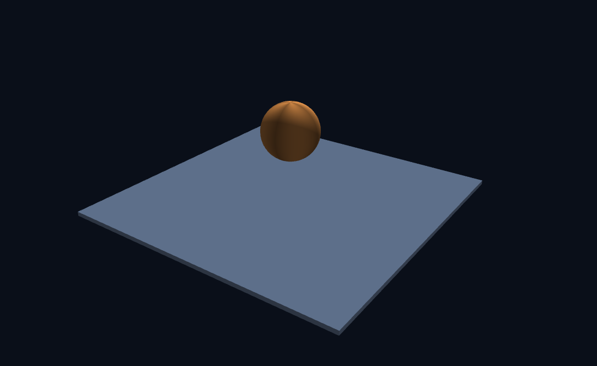
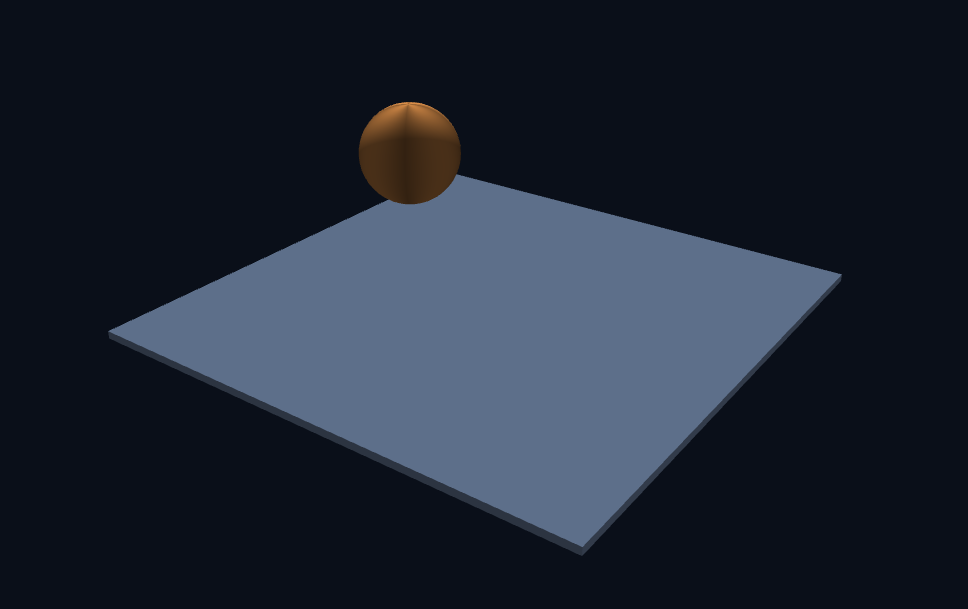
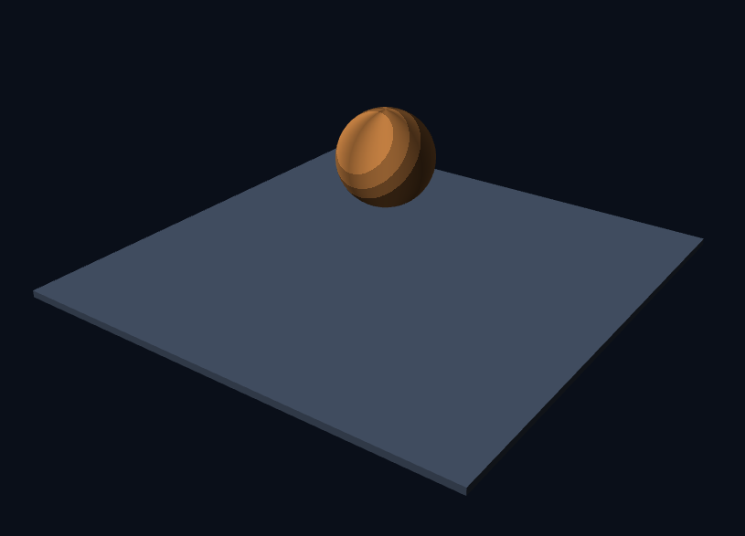

# 3주차 — 떠 있는 공에서 살아 있는 행성까지

- 이름: 이재원
- 저장소: https://github.com/uriel0425/cg-2026-solar
- 실행 (GitHub Pages)
  - Task 1: https://uriel0425.github.io/cg-2026-solar/week3/task1.html
  - Task 2: https://uriel0425.github.io/cg-2026-solar/week3/task2.html

## Task 1 — 삼각형에서 3차원 장면까지

### 6단계 순서 비교하기

6단계 기존

6단계 변환


### 8단계

적용한 프래그먼트 셰이더 : 계단식 음영


## Task 2 — 얼음과 사막의 행성


### 1. 의도

| 항목 | 내용 |
|---|---|
| 어떤 행성인가 | 높은 곳은 얼음, 낮은 곳은 사막으로 덮인 메마르고 추운 행성. 얼음이 녹은 물이 물길을 따라 낮은 분지로 흘러 호수를 이룬다. |
| 왜 이렇게 만들었나 | 실제 지형처럼 **고도 하나로 기후가 정해지는 행성**을 만들고 싶었다. 높으면 춥고(얼음), 낮으면 건조하며(사막), 물은 높은 곳에서 낮은 곳으로 흐른다는 규칙만으로 지형 전체를 설명할 수 있게 했다. |
| 목표 비율 | 얼음 50% · 사막 40% · 물길과 호수 10% |
| 예시와 다른 점 | 예시(바위 행성)는 바다·초록 육지·구름·도시 불빛이 있는 지구형 행성이다. 나는 바다, 식물, 구름, 도시를 모두 없앴다. 대신 사구 무늬, 빙하의 갈라진 틈, 얼음에 둘러싸인 분지, 녹은 물이 만든 물길을 새로 계산했다. 움직임도 구름 흐름 대신 **얼음선이 계절에 따라 오르내리는 것**과 **물 표면의 일렁임**으로 바꿨다. 대기 테두리는 푸른색 대신 먼지 낀 주황색으로 바꿨다. |

### 2. 방법

모든 무늬는 물체 기준 법선 `vSurf`(= `S`)로 계산한다. 그래서 행성이 자전해도 무늬가 표면에 붙어서 함께 돈다. 이미지 파일은 쓰지 않았다.

#### ① 고도 지도와 지형 나누기

```glsl
vec3 warp = vec3(fbm(S * 1.7 + 3.1), fbm(S * 1.7 + 7.3), fbm(S * 1.7 + 1.9));
vec3  P = S * 2.4 + warp * 1.2;
float h = fbm(P);
```

- `fbm`은 크기가 다른 잡음 5겹을 더한 값이다. 큰 덩어리와 잔 무늬가 함께 생기므로 이 값을 **고도**로 쓴다.
- 좌표 `S`를 그대로 넣으면 지형이 둥근 얼룩 모양이 된다. 그래서 또 다른 `fbm` 값(`warp`)만큼 좌표를 비틀어 넣었다(domain warp). 그러면 지형이 산맥처럼 길게 이어진다.
- 고도 기준선을 두 개 두었다. `h > snowLine`이면 얼음, `h < lakeLevel`이면 호수, 그 사이는 사막이다. 경계는 `smoothstep`으로 좁은 구간에서만 섞어서 또렷한 경계선을 만든다.
- `snowLine = 0.505 - 0.012 * sin(uTime * 0.25)`로 얼음선을 시간에 따라 움직였다. 겨울에는 얼음선이 내려와 얼음이 넓어지고, 여름에는 올라가 얼음이 녹는다.

#### ② 물길 — 잡음의 "등고선"을 강으로 쓰기

```glsl
float r       = noise3(S * 4.5 + warp * 2.0);
float down    = smoothstep(snowLine, lakeLevel, h);   // 얼음선에서 0, 호수에서 1
float width   = mix(0.016, 0.045, down);
float channel = 1.0 - smoothstep(width * 0.5, width, abs(r - 0.5));
```

- 고도와는 다른 잡음 `r`에서 **값이 정확히 0.5 근처인 점만** 남기면(`abs(r - 0.5) < width`) 꾸불꾸불한 선이 생긴다. 지도의 등고선과 같은 원리다.
- 이 선을 `riverZone`으로 걸러서 **얼음 가장자리부터 호수 높이까지만** 보이게 했다. 그래서 물길이 얼음에서 시작해 호수로 흘러드는 것처럼 보인다.
- `down`은 얼음선에서 0, 호수에서 1이 되는 값이다. 이 값으로 폭을 0.016에서 0.045로 넓혀서, 하류로 갈수록 강이 굵어지게 했다.
- 물 표면은 `noise3(S * 60.0 + uTime * ...)`으로 밝기를 조금씩 바꿔 일렁이게 했다. 물가의 모래는 아주 살짝만 어둡게 해서 젖은 느낌을 냈다.

#### ③ 얼음 분지 — 얼음에 둘러싸인 낮은 땅 찾기

```glsl
float hLow  = 0.5 * noise3(P) + 0.25 * noise3(P * 2.02);
float basin = smoothstep(0.365, 0.405, hLow) * (1.0 - ice);
```

- `h`는 잡음 5겹의 합이다. 그중 앞의 두 겹(큰 덩어리)만 따로 계산한 `hLow`는 "이 근처 **지역 전체**의 높이"로 볼 수 있다.
- **지역은 높은데(`hLow`가 큼) 이 점만 얼음선보다 낮으면** 높은 얼음 지대 안에 파인 분지다. 이런 곳은 주변이 추우니 사막이 될 수 없다고 보았다.
- 분지는 흙이 섞인 오래된 얼음처럼 어두운 청회색으로 칠했다. 녹은 물이 모이는 곳이라서 물길 폭을 0.08로 넓혔고, 더 촘촘한 잡음 `r2`로 지류를 한 겹 더 겹쳐 물길이 많아지게 했다.

#### ④ 사구와 크레바스

- **사구:** `sin(dot(S, 방향) * 70.0 + noise3(S * 7.0) * 9.0)`. 한 방향으로 반복되는 줄무늬 `sin`에 잡음을 더해서, 바람에 밀린 모래 물결처럼 휘어지게 했다.
- **크레바스:** `1.0 - abs(2.0 * noise3(S * 22.0) - 1.0)`. 이 식은 잡음이 0.5일 때만 1에 가까워지는 뾰족한 능선 모양이다. 그래서 얼음 위에 가는 선이 생기고, 이 선을 빙하의 갈라진 틈으로 썼다.
- **조명:** `dot(N, L)`로 낮과 밤의 경계를 유지했다. 물과 얼음에는 반사광(`pow(dot(N, H), 60.0)`)을 더해서 빛나 보이게 했다.

### 3. 뜻대로 안 된 부분과 고친 과정

| 단계 | 화면 | 문제 | 고친 방법 |
|---|---|---|---|
| 0. 이전 시도 |  | 처음에는 `sin(θ)`, `cos(φ)`를 조합한 마스크로 빙하 구역과 사막 구역을 직접 그렸다. 그랬더니 경계가 줄무늬처럼 규칙적이고 인위적이었다. 고도와 상관없이 색만 나눈 것이라 "높은 곳에 얼음이 생긴다"는 의도도 드러나지 않았다. | 구역을 손으로 정하지 않고 **고도 `h` 하나로 지형을 나누는 방식**으로 처음부터 다시 짰다. |
| 1. 고도 기반 첫 버전 |  | 호수 기준(`lakeLevel = 0.40`)이 너무 높아서 호수가 행성의 큰 부분을 덮었다. 예시의 지구 바다처럼 보였고, 물길은 너무 가늘어서 거의 보이지 않았다. | `lakeLevel`을 0.355로 낮추고, 물길 폭과 물길이 보이는 고도 구간을 넓혔다. |
| 2. 얼음이 부족 |  | 물길은 보이게 됐지만 얼음이 약 25%밖에 안 됐다. 고도 기준값을 감으로 정했기 때문이다. 얼음 둘레의 어두운 갈색 암반 띠와 물가의 젖은 모래가 갈색 등고선처럼 보였다. | 셰이더의 고도 계산을 파이썬으로 옮겨 **구 표면의 점 30만~40만 개에서 고도 분포를 측정**했다. 고도의 중간값(약 0.496)에 얼음선을 맞춰 얼음을 50%로 만들었다. 사막을 밝게 하고, 암반 띠와 젖은 모래 색을 모래와 거의 같게 바꿨다. |
| 3. 얼음 사이의 사막 |  | 비율은 맞았지만 얼음 한가운데 작은 사막 구멍이 남았다. 사방이 얼음인데 그 안만 사막인 것은 어색했다. | 지역 높이 `hLow`로 "얼음에 둘러싸인 분지"를 판별하는 계산을 추가했다(방법 ③). |
| 4. 분지 확인 |  | 분지로 판정된 곳을 진분홍으로 칠해 확인했다. 얼음 사이 구멍이 잘 잡혔지만, 처음 정한 분지 물길 폭(0.05)으로는 분지 안에 물길이 거의 보이지 않았다. | 분지 물길 폭을 0.08로 넓히고 지류 `r2`를 겹쳤다. 분지가 생기며 얼음과 물이 늘어난 만큼 얼음선을 0.505, 호수 높이를 0.31로 다시 맞췄다. |
| 5. 최종 |  | — | 측정 결과: 얼음 50.0% (흰 얼음 45.8% + 어두운 얼음 분지 4.2%), 사막 39.9%, 물길과 호수 10.1% |

> 0~5단계 캡처는 차이가 잘 보이도록 카메라를 행성 가까이 당겨서 찍었다. 실제 `task2.html`의 카메라 거리는 원래대로다.

### 4. 첨부 — 프래그먼트 셰이더 전체 코드

```glsl
#version 300 es
precision highp float;

in vec3 vColor;
in vec3 vNormal;      // 세계 기준 법선 — 빛 계산에 쓴다
in vec3 vSurf;        // 물체 기준 법선 — 무늬가 표면에 붙어 돌게 한다

uniform float uTime;

out vec4 fragColor;

/* ── 잡음 만들기 ───────────────────────────────────────────────
   이미지 파일 없이 무늬를 만들려면 "규칙적이지 않아 보이는 숫자"가 필요합니다.
   아래는 좌표를 넣으면 언제나 같은 0~1 값을 돌려주는 가짜 난수입니다.        */
float hash31(vec3 p) {
  p = fract(p * 0.3183099 + vec3(0.71, 0.113, 0.419));
  p *= 17.0;
  return fract(p.x * p.y * p.z * (p.x + p.y + p.z));
}

// 격자 꼭짓점의 난수를 부드럽게 섞어 "덩어리진" 잡음을 만듭니다
float noise3(vec3 x) {
  vec3 i = floor(x), f = fract(x);
  f = f * f * (3.0 - 2.0 * f);                 // 부드럽게 (smoothstep 과 같은 곡선)
  return mix(mix(mix(hash31(i + vec3(0,0,0)), hash31(i + vec3(1,0,0)), f.x),
                 mix(hash31(i + vec3(0,1,0)), hash31(i + vec3(1,1,0)), f.x), f.y),
             mix(mix(hash31(i + vec3(0,0,1)), hash31(i + vec3(1,0,1)), f.x),
                 mix(hash31(i + vec3(0,1,1)), hash31(i + vec3(1,1,1)), f.x), f.y), f.z);
}

// 크기가 다른 잡음을 여러 겹 더합니다 → 큰 덩어리와 잔 무늬가 함께 생깁니다
float fbm(vec3 p) {
  float v = 0.0, a = 0.5;
  for (int i = 0; i < 5; i++) { v += a * noise3(p); p *= 2.02; a *= 0.5; }
  return v;
}

void main() {
  vec3 N = normalize(vNormal);
  vec3 S = normalize(vSurf);
  vec3 L = normalize(vec3(0.85, 0.30, 0.30));
  float diff = max(dot(N, L), 0.0);

  /* ① 높이 지도 — fbm 값을 고도로 쓴다. 클수록 높은 땅이다.
     좌표를 fbm 으로 한 번 비틀어(domain warp) 지형이 둥근 얼룩이 아니라
     길쭉한 산맥 모양으로 이어지게 했다. */
  vec3 warp = vec3(fbm(S * 1.7 + 3.1), fbm(S * 1.7 + 7.3), fbm(S * 1.7 + 1.9));
  vec3  P = S * 2.4 + warp * 1.2;
  float h = fbm(P);

  /* ①-2 지역 고도 — fbm 의 앞 두 겹(큰 덩어리)만 따로 계산한다.
     h 는 "이 점의 높이", hLow 는 "이 근처 지역 전체의 높이" 라고 볼 수 있다.
     지역은 높은데 이 점만 낮다 = 높은 얼음 지대 안에 파인 분지. */
  float hLow = 0.5 * noise3(P) + 0.25 * noise3(P * 2.02);

  /* ② 고도 기준선 세 개.
     lakeLevel 아래 = 호수, snowLine 위 = 얼음.
     snowLine 을 uTime 으로 천천히 오르내려 얼음이 녹았다 얼었다 하는 계절을 표현한다. */
  float lakeLevel = 0.310;
  float season    = sin(uTime * 0.25);                 // -1(여름) ~ 1(겨울)
  float snowLine  = 0.505 - 0.012 * season;            // 겨울엔 얼음선이 내려와 얼음이 넓어진다

  /* ③ 사막 — 낮은 땅. 사구 무늬는 한 방향 줄무늬 sin 에
     잡음을 더해 물결처럼 휘게 만든다. */
  float duneWave = sin(dot(S, vec3(0.8, 0.2, 0.55)) * 70.0 + noise3(S * 7.0) * 9.0);
  float dune     = 0.5 + 0.5 * duneWave;
  vec3 sandLight = vec3(0.98, 0.84, 0.58);
  vec3 sandDark  = vec3(0.86, 0.66, 0.42);
  vec3 desert    = mix(sandDark, sandLight, dune * 0.6 + fbm(S * 12.0) * 0.4);

  /* ④ 중간 고도 — 얼음이 녹고 남은 자갈 비탈. 사막에서 얼음으로 넘어가는 얇은 띠.
     색을 모래와 거의 같게 두어 선처럼 튀지 않고 자연스럽게 이어지게 했다. */
  vec3 rock = mix(vec3(0.84, 0.68, 0.48), vec3(0.92, 0.80, 0.62), fbm(S * 18.0));
  float slope = smoothstep(snowLine - 0.04, snowLine - 0.01, h);
  vec3 albedo = mix(desert, rock, slope);

  /* ⑤ 얼음 — 높은 땅. 능선 잡음 1-|2n-1| 은 0.5 근처에서 뾰족해지므로
     가는 선으로 보인다 → 이것을 빙하의 갈라진 틈(크레바스)으로 썼다. */
  float crack  = 1.0 - abs(2.0 * noise3(S * 22.0) - 1.0);
  vec3 iceCol  = mix(vec3(0.93, 0.97, 1.00), vec3(0.55, 0.72, 0.86), smoothstep(0.88, 0.98, crack));
  float ice    = smoothstep(snowLine - 0.01, snowLine + 0.02, h);
  albedo = mix(albedo, iceCol, ice);

  /* ⑤-2 얼음 분지 — 얼음에 둘러싸인 낮은 땅은 추워서 사막이 될 수 없다고 보고
     어두운 얼음(흙과 섞인 오래된 얼음)으로 덮는다. 이곳으로 녹은 물이 모인다. */
  float basin   = smoothstep(0.365, 0.405, hLow) * (1.0 - ice);
  vec3  darkIce = mix(vec3(0.46, 0.54, 0.62), vec3(0.60, 0.67, 0.74), fbm(S * 14.0));
  albedo = mix(albedo, darkIce, basin);

  /* ⑥ 물길 — 다른 잡음 r 이 정확히 0.5 를 지나는 "등고선"만 남기면
     꾸불꾸불한 선이 된다. 이 선을 얼음 바로 아래에서 호수 높이까지만 보이게 하고,
     낮은 곳으로 갈수록 폭을 넓혀 하류일수록 강이 굵어지게 했다. */
  float r       = noise3(S * 4.5 + warp * 2.0);
  float down    = smoothstep(snowLine, lakeLevel, h);  // 얼음선에서 0, 호수에서 1
  float width   = mix(0.016, 0.045, down);
  width         = mix(width, 0.08, basin);               // 분지에서는 큰 물길
  float channel = 1.0 - smoothstep(width * 0.5, width, abs(r - 0.5));
  /* 분지에는 더 촘촘한 잡음 r2 로 지류를 하나 더 겹쳐 물길이 많아지게 한다. */
  float r2      = noise3(S * 9.0 + warp * 3.0);
  channel = max(channel, (1.0 - smoothstep(width * 0.5, width, abs(r2 - 0.5))) * basin);
  float riverZone = smoothstep(snowLine + 0.02, snowLine - 0.01, h)   // 얼음 가장자리부터 시작해
                  * smoothstep(lakeLevel - 0.01, lakeLevel + 0.01, h); // 호수에 닿을 때까지
  float river   = channel * riverZone;

  /* ⑦ 호수 — 가장 낮은 분지. 물이 모이는 곳이라 고도만으로 정한다. */
  float lake = smoothstep(lakeLevel + 0.005, lakeLevel - 0.005, h);

  /* ⑧ 물 주변 젖은 모래 — 물길·호수 근처 모래를 아주 살짝만 어둡게.
     너무 어두우면 갈색 등고선처럼 보여서 모래색과 거의 같게 했다. */
  float wet = max(smoothstep(width * 3.0, width, abs(r - 0.5)) * riverZone,
                  smoothstep(lakeLevel + 0.015, lakeLevel, h));
  albedo = mix(albedo, albedo * vec3(0.94, 0.91, 0.88), wet * (1.0 - ice));

  /* ⑨ 물 색 — 녹은 빙하물이라 청록색. 깊은 곳(고도가 더 낮은 곳)일수록 진하게.
     uTime 으로 잡음 좌표를 밀어 물 표면이 일렁이게 했다. */
  float depth   = smoothstep(lakeLevel, lakeLevel - 0.08, h);
  vec3 water    = mix(vec3(0.30, 0.72, 0.78), vec3(0.05, 0.28, 0.42), depth);
  float ripple  = noise3(S * 60.0 + vec3(0.0, uTime * 0.8, uTime * 0.5));
  water        *= 0.9 + 0.2 * ripple;
  float wetMask = max(river, lake) * (1.0 - ice);
  albedo = mix(albedo, water, wetMask);

  /* ⑩ 조명 — dot(N, L) 로 낮과 밤의 경계를 만든다(기존 유지).
     물과 얼음은 반짝이도록 반사광(하이라이트)을 더한다. */
  vec3 color = albedo * (0.06 + 0.94 * diff);
  vec3 V = vec3(0.0, 0.0, 1.0);                        // 카메라가 +z 쪽에서 본다
  vec3 H = normalize(L + V);
  float spec = pow(max(dot(N, H), 0.0), 60.0) * step(0.0, dot(N, L));
  color += vec3(1.0, 0.95, 0.85) * spec * (wetMask * 0.6 + ice * 0.25);

  /* ⑪ 대기 — 먼지가 많은 행성이라 가장자리를 푸른색 대신 주황빛으로. */
  float rim = pow(1.0 - abs(dot(N, V)), 3.0);
  color += vec3(0.85, 0.50, 0.25) * rim * diff * 0.6;

  fragColor = vec4(color, 1.0);
}
```
