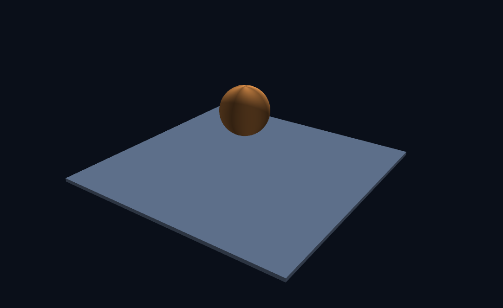
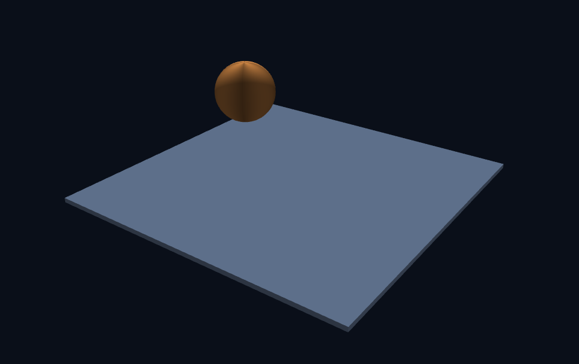
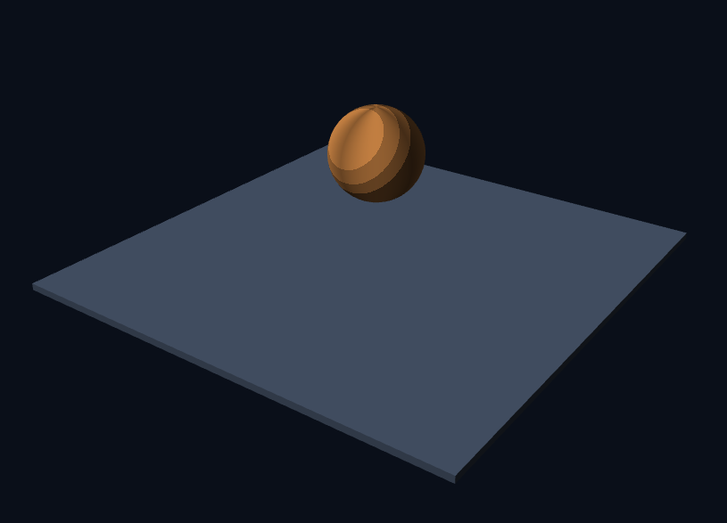

# 3주차 — 떠 있는 공에서 살아 있는 행성까지

- 이름: 이재원
- 저장소: https://github.com/uriel0425/cg-2026-solar
- 실행: [Task 1](task1.html) · [Task 2](task2.html) · [Task 3](task3.html)

## Task 1 — 삼각형에서 3차원 장면까지

### 6단계 순서 비교하기

6단계 기존

6단계 변환

### 8단계

적용한 프래그먼트 셰이더 : 계단식 음영

